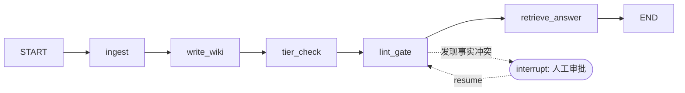

# langgraph-memory-demo

> 用 LangGraph 实现的 **Agent 跨会话长期记忆层**：从群消息流中抽取事实、编译为互链 Markdown 知识库，带冷热分层、增量同步与人工审批防腐门——"感知 → 抽取 → 存储 → 防腐 → 检索"全链路状态机。

## 架构



| 节点 | 职责 | 对应的工程概念 |
|---|---|---|
| `ingest` | 按 watermark 增量拉取新消息，抽取结构化事实（claim + evidence） | 断点续传 / 增量同步 |
| `write_wiki` | 事实写入互链 Markdown 知识库（people / projects / knowledge 三类实体页） | 知识图谱化存储 |
| `tier_check` | 按事实密度对页面做 hot/cold 分层升降级，重建全库索引 | 冷热分层 |
| `lint_gate` | 同一实体同一属性出现多口径 → `interrupt()` 挂起，等人工审批后留痕 | 防腐机制 + human-in-the-loop |
| `retrieve_answer` | 跨会话检索回答，每条结论带证据来源页面 | 引用溯源 / RAG |

跨会话记忆与状态持久化由 LangGraph `SqliteSaver` checkpoint 承担：同一 `thread_id` 的多轮 `invoke` 共享知识库与审批状态。

## 快速开始

```bash
pip install -r requirements.txt
python main.py
```

无需任何 API Key：事实抽取用规则实现以便离线运行，生产环境替换为 LLM 结构化抽取即可，节点接口与图结构不变。

## 运行效果

第一轮：4 条群消息入库，其中"项目截止时间"发生口径变更，触发防腐检查：

```
[write_wiki] projects\Phoenix.md += 「截止时间：10月15日」
[write_wiki] projects\Phoenix.md += 「截止时间：11月1日」
[tier_check] Phoenix → hot（3 条事实）

>>> 图在 lint_gate 挂起（interrupt = human-in-the-loop），等待人工审批：
    冲突：Phoenix 的「截止时间」存在多个取值：['10月15日', '11月1日']
>>> 人工决策：以最新口径为准（resume=True）

[lint_gate] 人工审批通过：以最新口径为准，旧口径已在页面留痕作废
```

第二轮（新会话）：1 条新消息入库（旧消息被水位线跳过），跨会话提问得到带引用的回答：

```
[ingest] 水位线=4，本轮 1 条消息，跳过已消费 0 条，新消费 1 条
[retrieve_answer] 问题：Phoenix 项目什么时候截止？谁负责？

最终回答：
检索到以下相关事实：
  - 负责：Phoenix 项目（证据：msg#1）　—— 来源：people\张伟.md
  - 截止时间：10月15日（证据：msg#1）　—— 来源：projects\Phoenix.md
  - 截止时间：11月1日（证据：msg#3）　—— 来源：projects\Phoenix.md
  - [lint] 「截止时间」存在多口径，人工审批以最新值为准，旧口径作废　—— 来源：projects\Phoenix.md
  - 周会：本周五下午，3 号会议室（证据：msg#5）　—— 来源：projects\Phoenix.md
```

## 目录结构

```
langgraph-memory-demo/
├── main.py                  # 入口：建图、跑两轮会话、处理 interrupt 审批
├── memory_graph/
│   ├── state.py             # MemoryState：图的全局状态定义
│   ├── nodes.py             # 五个节点实现
│   ├── store.py             # WikiStore：Markdown 知识库持久化层
│   └── sample_data.py       # 示例群消息（含故意的口径冲突）
└── data/                    # 运行产物：wiki/ 知识库 + checkpoints.db
```
